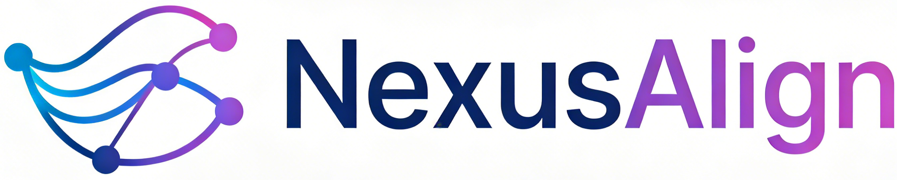

<p align="center">
  
</p>

[](LICENSE) [](https://www.python.org/downloads/) [](https://pytorch.org/)

NexusAlign is a unified research framework for tracking, reproducing, and extending foundation model algorithms.

- [Updates](#-updates)
- [Reproduced Algorithms](#-reproduced-algorithms)
- [Installation](#-installation)
- [Citation](#-citation)

## 🔥 Updates

- **[2026-10-18]** Add [DiffusionNFT](reproduce/diffusion_nft) on SD3.5-M with GenEval, OCR, and PickScore rewards.
- **[2026-10-17]** Add [Flow-GRPO](reproduce/flow_grpo) on SD3.5-M with GenEval, OCR, and PickScore rewards.
- **[2026-10-14]** Add [MeanFlow](reproduce/meanflow) and [iMeanFlow](reproduce/imeanflow) on ImageNet 256×256.

## 🔁 Reproduced Algorithms

| Algorithm | Paper |
|---|---|
| [DiffusionNFT](reproduce/diffusion_nft) | [*DiffusionNFT: Online Diffusion Reinforcement with Forward Process*](https://arxiv.org/abs/2509.16117) (ICLR 2026) |
| [Flow-GRPO](reproduce/flow_grpo) | [*Flow-GRPO: Training Flow Matching Models via Online RL*](https://arxiv.org/abs/2505.05470) (NeurIPS 2025) |
| [iMeanFlow](reproduce/imeanflow) | [*Improved Mean Flows: On the Challenges of Fastforward Generative Models*](https://arxiv.org/abs/2512.02012) (CVPR 2026) |
| [MeanFlow](reproduce/meanflow) | [*Mean Flows for One-step Generative Modeling*](https://arxiv.org/abs/2505.13447) (NeurIPS 2025) |

## 📦 Installation

**Requirements**: Linux, Python ≥3.11, and NVIDIA GPUs. `uv sync` installs PyTorch 2.12 (CUDA 12.6) and the exact versions pinned in `uv.lock`.

```bash
git clone https://github.com/junkunyuan/NexusAlign.git
cd NexusAlign
pip install uv && uv sync
source .venv/bin/activate
```

## 📚 Citation

```bibtex
@misc{nexus-align-2026,
  title = {NexusAlign: A Unified Research Framework for Tracking, Reproducing, and Extending Foundation Model Algorithms},
  author = {Junkun Yuan},
  year = {2026},
  url = {https://github.com/junkunyuan/NexusAlign}
}
```
